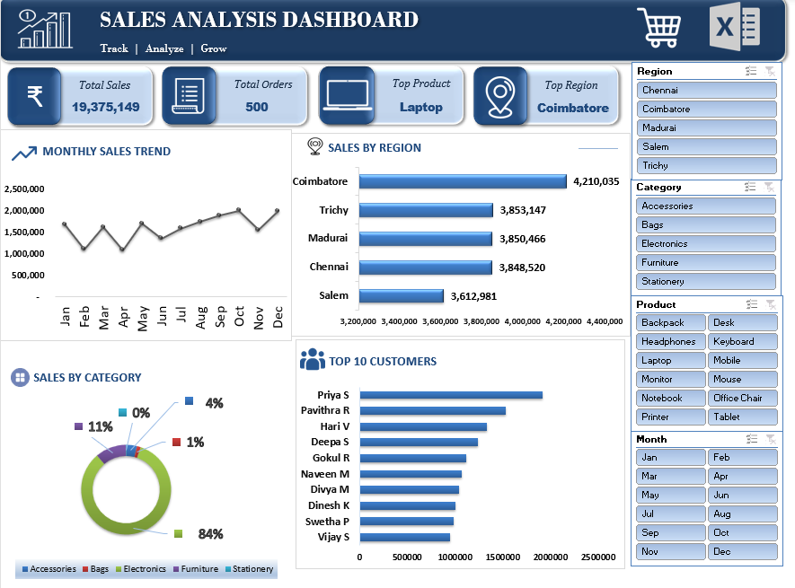

# Excel Sales Analysis Dashboard

## Project Overview

This project analyzes sales data using Microsoft Excel to understand sales performance across products, customers, and regions. An interactive dashboard helps users explore the data and identify important business insights.

## Objectives

* Analyze overall sales performance.
* Identify top-performing products and customers.
* Compare sales across different regions.
* Create an interactive dashboard using slicers.
* Support data-driven business decisions.

## Tools Used

* Microsoft Excel
* Pivot Tables
* Pivot Charts
* Slicers
* Data Visualization

## Dashboard Features

* **Total Sales:** Displays overall sales revenue.
* **Total Orders:** Shows the number of orders.
* **Top Product:** Highlights the best-performing product based on the selected analysis.
* **Region Analysis:** Compares sales across regions.
* **Product Analysis:** Helps identify products with higher and lower sales.
* **Customer Analysis:** Highlights top customers by sales.
* **Interactive Slicers:** Allow users to filter the dashboard and explore different views.

## Key Business Questions

1. What are the total sales and number of orders?
2. Which products generate the highest sales?
3. Which regions contribute the most to sales?
4. Who are the top customers?
5. How does sales performance change when filters are applied?

## Business Value

This dashboard makes sales information easier to understand, helps identify high-performing products and regions, and supports business planning and decision-making.

## Project Files

* Excel dashboard workbook
* Dataset used for analysis (if shareable)
* Dashboard screenshots

## Skills Demonstrated

Data Analysis | Excel | Pivot Tables | Pivot Charts | Slicers | Dashboard Design | Business Insights

## Dashboard Preview

## Project Presentation

[View the Sales Analysis Presentation](SALES%20ANALYSIS%20DASHBOARD%20ppt.pptx)

